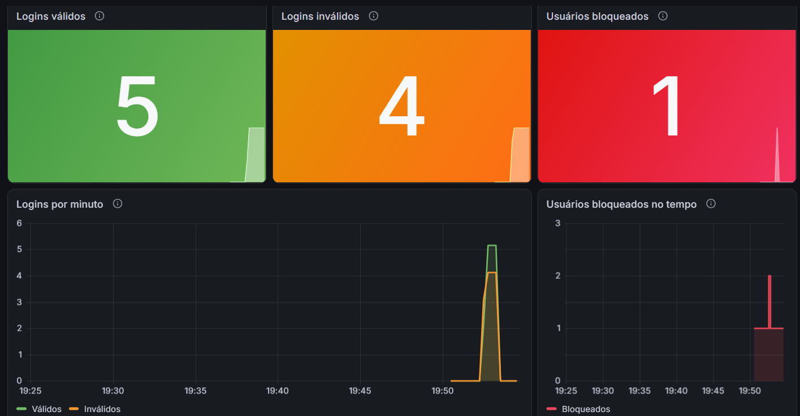

# MS-AV-02 - Segurança e Observabilidade

Mecanismo de login RESTful em Spring Boot 4.1.1 com:

- login validado pela tabela `usuarios` e bloqueio na 2ª falha seguida (tabela `login_attempts`)
- roles controladas pelo `JdbcUserDetailsManager` (tabelas `users` e `authorities`)
- indicadores de logins válidos, logins inválidos e usuários bloqueados (Micrometer + Prometheus)
- dashboard no Grafana
- documentação OpenAPI com Swagger

## Tecnologias

Java 17, Spring Boot 4.1.1 (Web, Security, Data JPA, Validation, Actuator), H2 em memória, springdoc-openapi 3.1.1, Micrometer Prometheus, Prometheus e Grafana.

## Como executar

```bash
./mvnw spring-boot:run        # Linux / Mac / Git Bash
mvnw.cmd spring-boot:run      # Windows (cmd / PowerShell)
```

Ou abrir a pasta no VS Code e rodar a classe `LoginSegurancaApplication`.

A aplicação sobe em `http://localhost:8080`.

| O quê | Endereço |
| --- | --- |
| Swagger | http://localhost:8080/swagger-ui.html |
| OpenAPI (JSON) | http://localhost:8080/v3/api-docs |
| Métricas Prometheus | http://localhost:8080/actuator/prometheus |
| Console H2 | http://localhost:8080/h2-console (JDBC URL `jdbc:h2:mem:segurancadb`, usuário `sa`, senha `password`) |

## Usuários de teste (criados pelo `data.sql`)

| Usuário | Senha | Role | Situação |
| --- | --- | --- | --- |
| admin | admin123 | ROLE_ADMIN | ativo |
| manutencao | manut123 | ROLE_MANUTENCAO | ativo |
| joao | joao123 | ROLE_USER | ativo |
| maria | maria123 | ROLE_USER | ativo |
| carlos | carlos123 | ROLE_USER | **bloqueado** (para testar o unlock) |

## Endpoints

| Método | Caminho | Acesso | Corpo | Retornos |
| --- | --- | --- | --- | --- |
| POST | `/login` | público | `{"username": "", "senha": ""}` | 200 válido, 401 inválido ou bloqueado |
| PUT | `/trocarsenha/{userid}` | público | `{"atual": "", "nova": ""}` | 200, 400, 401 senha atual errada ou bloqueado, 404 |
| POST | `/` | ROLE_MANUTENCAO | `{"username": "", "senha": ""}` | 201, 400, 401, 403, 409 já existe |
| GET | `/` | ROLE_MANUTENCAO | - | 200 lista em JSON, 401, 403 |
| PUT | `/unlock/{userid}` | ROLE_ADMIN | - | 200, 401, 403, 404 |

Os endpoints protegidos usam **Basic Auth** (`Authorization: Basic base64(usuario:senha)`). No Swagger, clique em **Authorize** e informe usuário e senha.

Exemplos:

```bash
curl -X POST http://localhost:8080/login -H "Content-Type: application/json" -d '{"username":"joao","senha":"joao123"}'
curl -u manutencao:manut123 http://localhost:8080/
curl -u manutencao:manut123 -X POST http://localhost:8080/ -H "Content-Type: application/json" -d '{"username":"ana","senha":"ana123"}'
curl -X PUT http://localhost:8080/trocarsenha/ana -H "Content-Type: application/json" -d '{"atual":"ana123","nova":"nova123"}'
curl -u admin:admin123 -X PUT http://localhost:8080/unlock/carlos
```

O script `testes.sh` executa um roteiro com todos os cenários (no Windows, rode pelo Git Bash).

## Regras implementadas

- **Login:** confere usuário e senha na tabela `usuarios`. Com sucesso, zera as falhas do usuário.
- **Bloqueio:** cada senha errada soma 1 em `failed_attempts`. Como o enunciado pede bloqueio quando o usuário "falhar mais de uma vez", na **2ª falha seguida** o usuário fica `locked = TRUE` (com `locked_at` preenchido). Um usuário bloqueado recebe 401 mesmo com a senha certa.
- **Bloqueio também no Spring Security:** ao bloquear, o usuário fica `enabled = false` na tabela `users` (via `JdbcUserDetailsManager.updateUser`). Ao desbloquear, volta a `true`.
- **Troca de senha:** confere a senha atual no banco e atualiza `usuarios` e `users`. Usuário bloqueado não troca a senha.
- **Cadastro:** grava em `usuarios`, `login_attempts` e, pelo `JdbcUserDetailsManager.createUser`, em `users`/`authorities` com `ROLE_USER`.
- **Listagem:** devolve username, roles, se está bloqueado e a quantidade de falhas. A senha nunca é devolvida.
- **Unlock:** zera as falhas, remove o bloqueio e reabilita o usuário.

### Observações sobre o SQL do enunciado

- O `CREATE TABLE login_attempts` do enunciado tem uma vírgula depois de `updated_at`, o que dá erro de sintaxe. Ela foi removida no `data.sql`.
- A coluna `usuarios.senha` é `VARCHAR(10)`, o que não comporta um hash bcrypt. Por isso, nessa tabela a senha fica em texto, e a nova senha é validada com no máximo 10 caracteres. Na tabela `users` do Spring Security ela é gravada com o prefixo `{noop}`.

## Indicadores

Criados na classe `LoginMetrica`:

| Métrica (Prometheus) | Tipo | Significado |
| --- | --- | --- |
| `login_validos_total` | counter | logins válidos |
| `login_invalidos_total` | counter | logins inválidos (senha errada, usuário inexistente ou bloqueado) |
| `usuarios_bloqueados` | gauge | total atual de usuários bloqueados (lido da tabela `login_attempts`) |

## Prometheus e Grafana

Com Docker, dentro da pasta `observabilidade`:

```bash
docker compose up -d
```

- Prometheus: http://localhost:9090 (o alvo `login-seguranca` deve aparecer como UP em Status > Targets)
- Grafana: http://localhost:3000 (usuário `admin`, senha `admin`)

O Grafana já sobe com a conexão ao Prometheus e com o dashboard **Login - Segurança e Observabilidade**, que está em `observabilidade/grafana/dashboards/dashboard-login.json`.

Sem Docker (Prometheus e Grafana instalados na máquina):

1. Troque o alvo em `observabilidade/prometheus.yml` para `localhost:8080` e inicie o Prometheus com esse arquivo.
2. No Grafana, crie a conexão com o Prometheus (`http://localhost:9090`).
3. Importe o dashboard em Dashboards > New > Import, escolhendo o arquivo `dashboard-login.json` e selecionando o Prometheus como fonte de dados.

## Dashboard



O dashboard exportado está em `observabilidade/grafana/dashboards/dashboard-login.json`.
